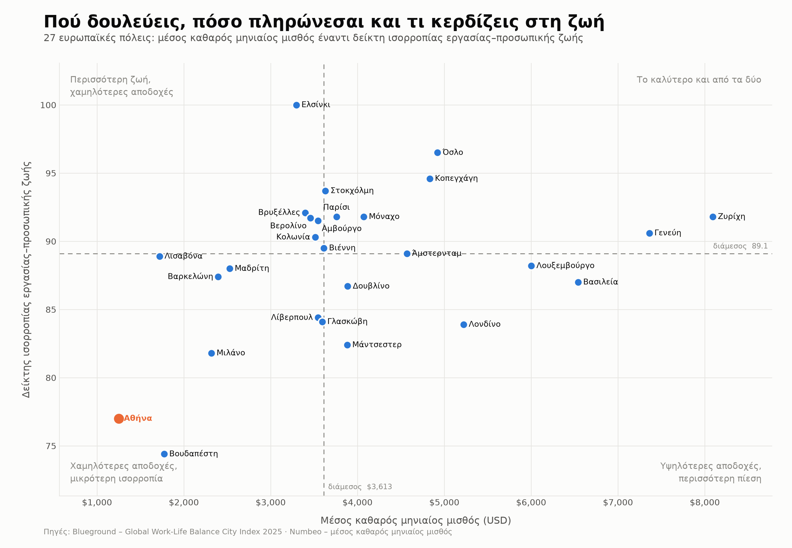

# Μισθός vs ισορροπία ζωής — 27 ευρωπαϊκές πόλεις

Πόσο πληρώνεσαι και τι ζωή σου μένει, ανά ευρωπαϊκή πόλη. Το repo παίρνει τον
**Global Work-Life Balance City Index 2025** της Blueground (75 πόλεις παγκοσμίως),
κρατάει **μόνο τις ευρωπαϊκές**, και τον ενώνει με τον μέσο καθαρό μηνιαίο μισθό
του **Numbeo**.

<picture>
  <source media="(prefers-color-scheme: dark)" srcset="output/work_life_balance_europe_el_dark.png">
  
</picture>

[Αγγλική έκδοση](output/work_life_balance_europe_en.png) · [δεδομένα σε CSV](data/europe_work_life_balance.csv)

## Τι δείχνουν τα δεδομένα

- **Μέσα στην Ευρώπη ο μισθός δεν αγοράζει ισορροπία — αλλά ούτε την κοστίζει.**
  Η συσχέτιση μισθού και δείκτη είναι ασθενής: Pearson **r = 0,37**, Spearman
  **ρ = 0,29** (n = 27). Δεν υπάρχει το δίλημμα «λεφτά ή ζωή» που υπονοεί η
  τυπική εκδοχή του γραφήματος· απλώς τα δύο μεγέθη δεν ευθυγραμμίζονται.
- **Τα τεταρτημόρια είναι σχεδόν μοιρασμένα**: 9 πόλεις πάνω από τη διάμεσο και στα
  δύο, 8 κάτω και στα δύο, και 10 μοιρασμένες. Η διαγώνιος κυριαρχεί οριακά.
- **Το Ελσίνκι είναι #1 στον κόσμο στην ισορροπία με μισθό κάτω από την ευρωπαϊκή
  διάμεσο** ($3.296 έναντι $3.613). Η Ζυρίχη πληρώνει **2,5×** το Ελσίνκι και
  βγάζει χαμηλότερο δείκτη.
- **Η Αθήνα έχει τον χαμηλότερο μισθό από τις 27** ($1.251) και τον δεύτερο
  χαμηλότερο δείκτη (77,0 — μόνο η Βουδαπέστη είναι πιο κάτω). Παγκοσμίως είναι
  **41η από 75**: όχι στον πάτο της λίστας, αλλά τελευταία ζώνη της Ευρώπης.

## Πώς διαφέρει από το αρχικό infographic

| | Αρχικό γραφικό | Εδώ |
|---|---|---|
| Πόλεις | 75 παγκοσμίως | 27 ευρωπαϊκές |
| Άξονες | άνισα διαστήματα (τεταρτημόρια κατάταξης) | **γραμμικοί**, πραγματικές τιμές |
| Όρια τεταρτημορίων | αυθαίρετα | **διάμεσος** του ευρωπαϊκού δείγματος |
| Βιέννη | λείπει | περιλαμβάνεται (#17 παγκοσμίως) |
| Δεδομένα | μόνο εικόνα | CSV + αναπαραγώγιμο script |

Η Κωνσταντινούπολη (#74) είναι στον δείκτη αλλά μένει εκτός: διηπειρωτική, και το
Numbeo την κατατάσσει στη Δυτική Ασία, όχι στον ευρωπαϊκό πίνακα τιμών.

## Αναπαραγωγή

```bash
pip install -r requirements.txt

python src/fetch_numbeo.py      # μισθοί από το Numbeo -> data/numbeo_prices.csv
python src/build_dataset.py     # ένωση + φίλτρο Ευρώπης -> data/europe_work_life_balance.csv
python src/plot_chart.py        # γραφήματα (el/en × light/dark) -> output/
```

Επιλογές:

```bash
python src/fetch_numbeo.py --with-rent      # +ενοίκιο γκαρσονιέρας στο κέντρο
python src/fetch_numbeo.py --currency EUR   # άλλο νόμισμα
python src/plot_chart.py --lang en --theme light
```

Με `--with-rent` προστίθενται οι στήλες `rent_1br_centre_usd` και `rent_share_pct`
(ποσοστό του καθαρού μισθού που φεύγει σε ενοίκιο). Είναι εκτός προεπιλογής γιατί
είναι δεύτερο αίτημα και το Numbeo κόβει εύκολα την IP με **429** — το script κάνει
backoff, αλλά μπορεί να χρειαστεί να ξαναδοκιμάσεις αργότερα.

## Δομή

```
data/wlb_index_2025_raw.csv        και οι 75 πόλεις, 20 δείκτες (στατικό, από Blueground)
data/numbeo_prices.csv             ό,τι κατέβασε το fetch_numbeo.py
data/europe_work_life_balance.csv  το τελικό dataset των 27 πόλεων
src/fetch_numbeo.py                scraper του Numbeo
src/build_dataset.py               ένωση, φίλτρο Ευρώπης, ελληνικά ονόματα
src/plot_chart.py                  το γράφημα τεταρτημορίων
output/                            PNG σε 2 γλώσσες × 2 θέματα
```

### Στήλες του `europe_work_life_balance.csv`

| Στήλη | Τι είναι |
|---|---|
| `city`, `city_el` | όνομα πόλης (αγγλικά / ελληνικά) |
| `country`, `country_el`, `iso2` | χώρα |
| `global_rank` | θέση στις 75 πόλεις του δείκτη |
| `baseline_index` | ο δείκτης ισορροπίας, κλίμακα 50–100 |
| `net_salary_usd` | μέσος καθαρός μηνιαίος μισθός, USD |
| `overworked_pct` | % πλήρως απασχολούμενων που δουλεύουν >48 ώρες/εβδομάδα |
| `vacations_taken` | μέρες άδειας που πράγματι λαμβάνονται |
| `paid_parental_leave_days` | ημέρες αμειβόμενης γονικής άδειας |
| `right_to_disconnect` | S / M / RW / W — ισχύς του δικαιώματος αποσύνδεσης |

## Δεδομένα

- **Blueground — Global Work-Life Balance City Index 2025.** 16 παράγοντες σε τρεις
  κατηγορίες (ένταση εργασίας, βιωσιμότητα πόλης, κοινωνία & θεσμοί), κανονικοποιημένοι
  σε κλίμακα 50–100 με min-max πάνω σε z-scores. Ο δείκτης είναι **σχετικός ως προς τις
  75 πόλεις** — δεν μετράει απόλυτο μέγεθος.
  <https://www.theblueground.com/resources/best-cities-work-life-balance>
- **Numbeo — Average Monthly Net Salary (After Tax).** Crowdsourced, ανανεώνεται
  συνεχώς, οπότε το `net_salary_usd` αλλάζει κάθε φορά που τρέχει το scraper.
  <https://www.numbeo.com/cost-of-living/>

Οι δύο πηγές έχουν διαφορετικές ημερομηνίες αναφοράς· ο δείκτης είναι του 2025, οι
τιμές του Numbeo είναι η τρέχουσα κυλιόμενη εκτίμηση.

## Πλήρης πίνακας

| Πόλη | Χώρα | Θέση (από 75) | Δείκτης | Καθαρός μισθός |
|---|---|---:|---:|---:|
| Ελσίνκι | Φινλανδία | 1 | 100,0 | $3.296 |
| Όσλο | Νορβηγία | 2 | 96,5 | $4.921 |
| Κοπεγχάγη | Δανία | 3 | 94,6 | $4.833 |
| Στοκχόλμη | Σουηδία | 4 | 93,7 | $3.630 |
| Βρυξέλλες | Βέλγιο | 8 | 92,1 | $3.399 |
| Παρίσι | Γαλλία | 9 | 91,8 | $3.758 |
| Ζυρίχη | Ελβετία | 10 | 91,8 | $8.092 |
| Μόναχο | Γερμανία | 11 | 91,8 | $4.072 |
| Βερολίνο | Γερμανία | 12 | 91,7 | $3.458 |
| Αμβούργο | Γερμανία | 13 | 91,5 | $3.545 |
| Γενεύη | Ελβετία | 15 | 90,6 | $7.361 |
| Κολωνία | Γερμανία | 16 | 90,3 | $3.513 |
| Βιέννη | Αυστρία | 17 | 89,5 | $3.613 |
| Άμστερνταμ | Ολλανδία | 18 | 89,1 | $4.570 |
| Λισαβόνα | Πορτογαλία | 19 | 88,9 | $1.719 |
| Λουξεμβούργο | Λουξεμβούργο | 20 | 88,2 | $6.002 |
| Μαδρίτη | Ισπανία | 21 | 88,0 | $2.527 |
| Βαρκελώνη | Ισπανία | 23 | 87,4 | $2.395 |
| Βασιλεία | Ελβετία | 24 | 87,0 | $6.541 |
| Δουβλίνο | Ιρλανδία | 25 | 86,7 | $3.887 |
| Λίβερπουλ | Ηνωμένο Βασίλειο | 26 | 84,4 | $3.543 |
| Γλασκώβη | Ηνωμένο Βασίλειο | 27 | 84,1 | $3.594 |
| Λονδίνο | Ηνωμένο Βασίλειο | 29 | 83,9 | $5.222 |
| Μάντσεστερ | Ηνωμένο Βασίλειο | 31 | 82,4 | $3.881 |
| Μιλάνο | Ιταλία | 32 | 81,8 | $2.319 |
| **Αθήνα** | **Ελλάδα** | **41** | **77,0** | **$1.251** |
| Βουδαπέστη | Ουγγαρία | 52 | 74,4 | $1.773 |

---

## In English

Work-life balance against net salary for the 27 European cities in Blueground's
Global Work-Life Balance City Index 2025, joined with Numbeo's average monthly net
salary. Within Europe the two are only weakly related (Pearson r = 0.37, Spearman
ρ = 0.29, n = 27) — the "money or life" trade-off the usual version of this chart
implies does not show up. Helsinki ranks first in the world on balance while paying
below the European median; Zurich pays 2.5× Helsinki and scores lower. Athens has
the lowest salary of the 27 and the second-lowest balance score.

Run `pip install -r requirements.txt`, then `fetch_numbeo.py` → `build_dataset.py`
→ `plot_chart.py`. Charts render in Greek and English, light and dark.

## Άδεια

[MIT](LICENSE). Τα δεδομένα ανήκουν στις αντίστοιχες πηγές (Blueground, Numbeo) και
χρησιμοποιούνται εδώ για ανάλυση και αναφορά.
